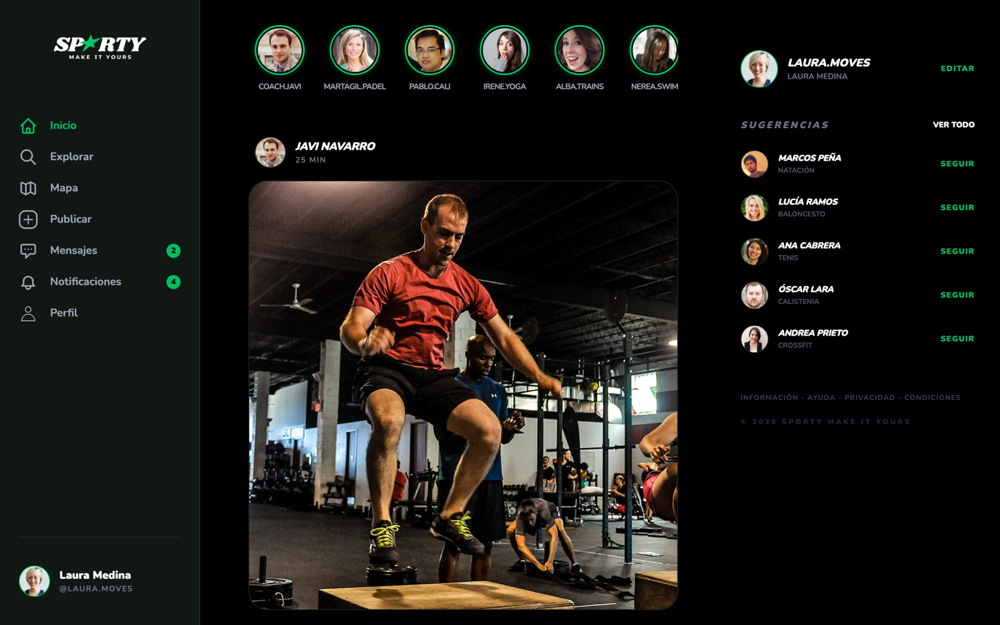
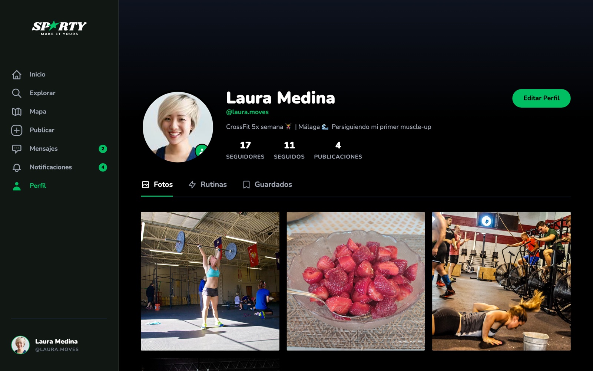
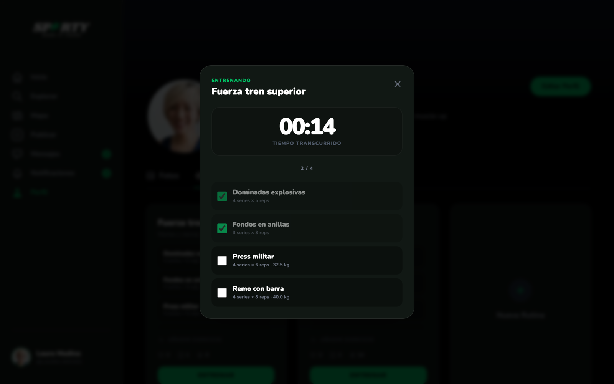
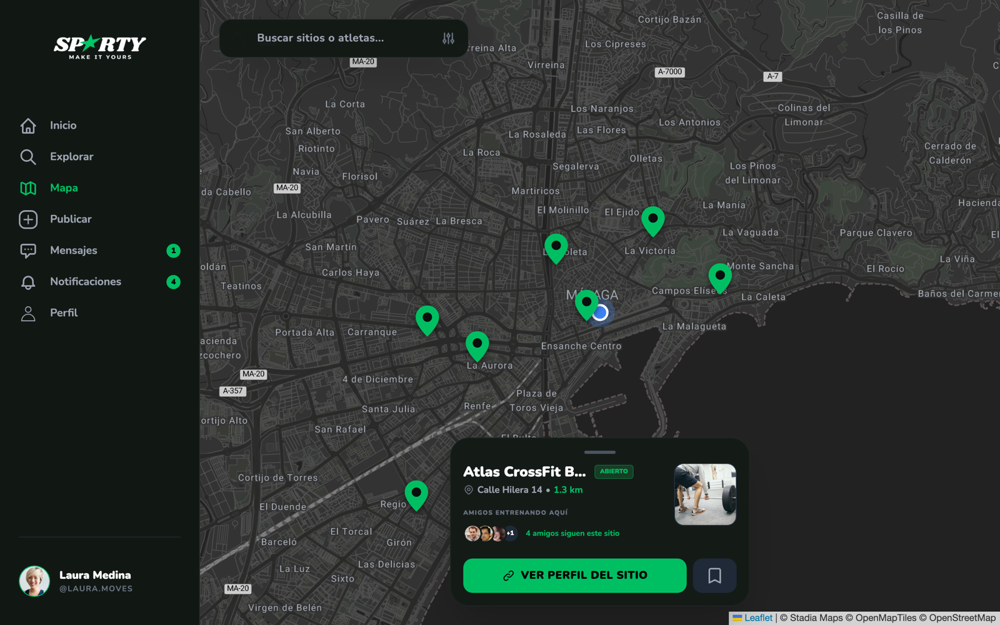
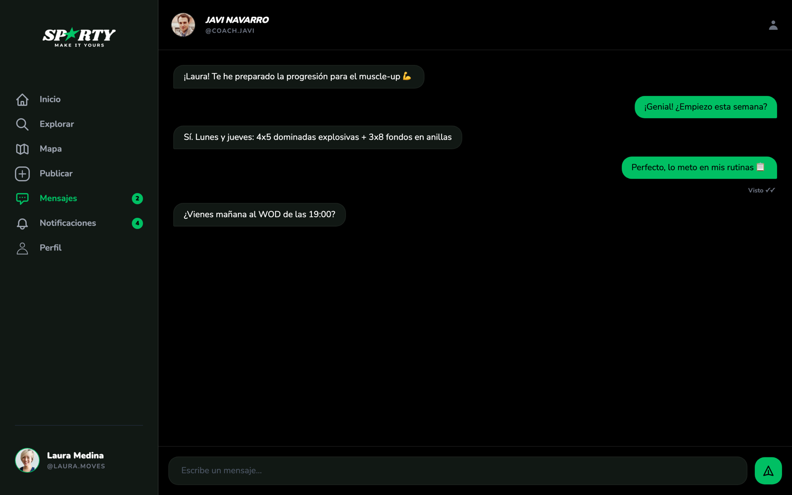
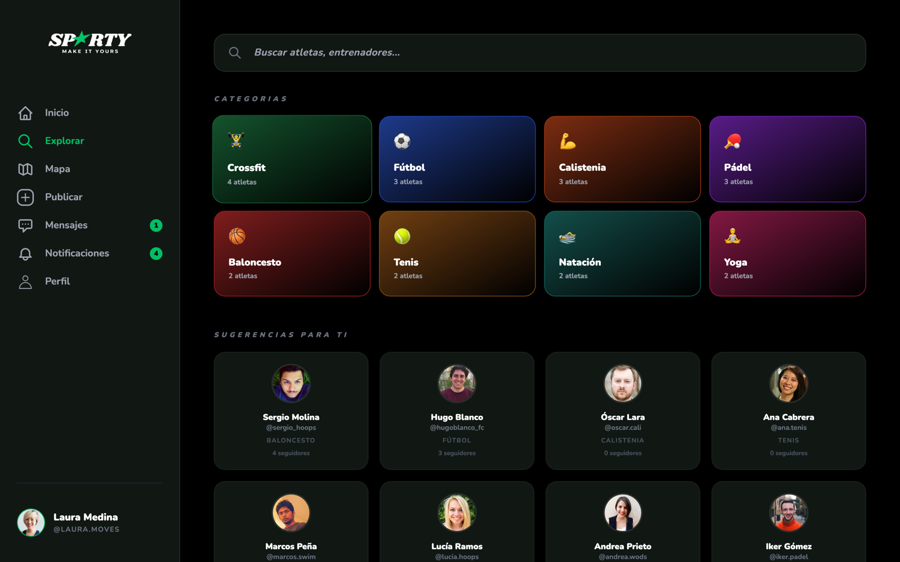
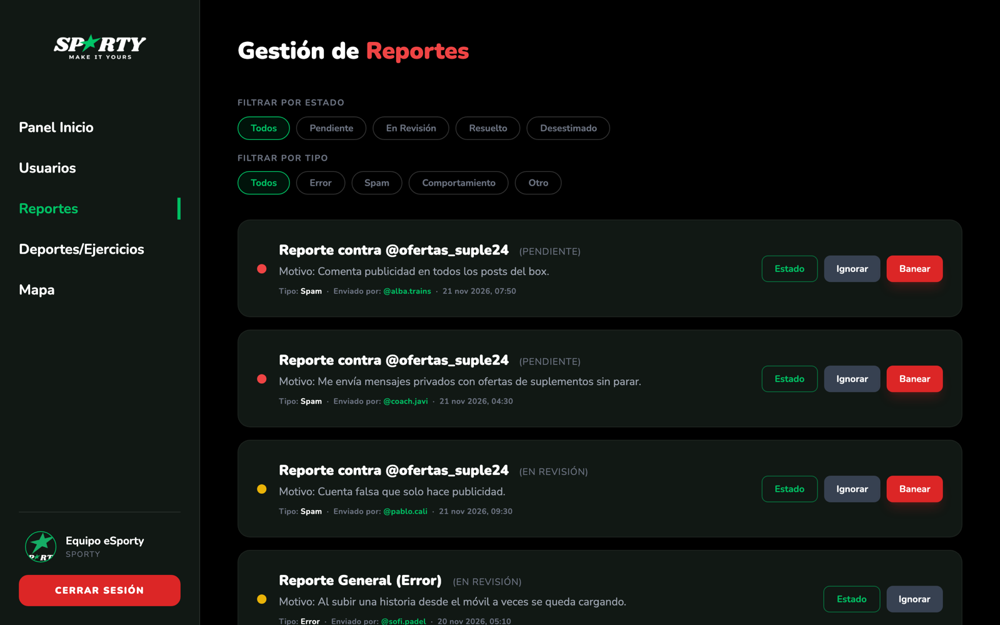
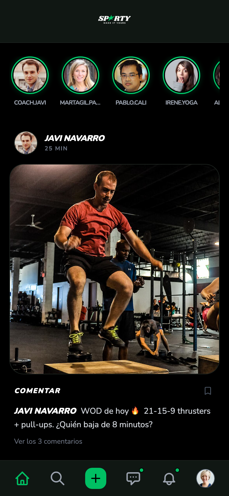

<div align="center">
  
  <h1>Sporty</h1>
  <p>
    <a href="https://esporty.jcloudhosting.com"><b>Web</b></a>
  </p>
  <p>La red social para los que entrenan: comparte tus <b>entrenamientos</b>, crea <b>rutinas</b> y encuentra <b>gimnasios</b> cerca de ti.<br />Sigue a otros atletas y entrenadores, chatea con ellos y entrena con sus rutinas.</p>
</div>

<p align="center">
  
</p>

## Características

- **Feed e historias**: publicaciones con foto de la gente a la que sigues e historias que desaparecen a las 24 horas. Comenta, guarda las publicaciones que quieras repasar y publica las tuyas en dos clics.
- **Perfiles**: foto, bio, deporte favorito, seguidores y seguidos. Las cuentas pueden ser privadas, con solicitudes de seguimiento, y los entrenadores llevan su insignia de verificado.
- **Rutinas**: crea rutinas con series, repeticiones y peso, y entrénalas con cronómetro y checklist. Dale like a las rutinas de otros usuarios o guárdalas para usarlas tú.
- **Explorar**: busca atletas y entrenadores por nombre o por deporte y descubre perfiles nuevos.
- **Mensajes**: chat directo entre usuarios. Los mensajes nuevos llegan sin recargar la página.
- **Notificaciones**: nuevos seguidores, comentarios y mensajes, con contadores en el menú.
- **Mapa de gimnasios**: gimnasios cercanos a tu ubicación con su distancia, si están abiertos y qué amigos los siguen. Sigue los tuyos.
- **Panel de administración**: métricas, gestión de usuarios, reportes por estado y tipo, y baneos permanentes o temporales.

<table>
  <tr>
    <td width="50%"></td>
    <td width="50%"></td>
  </tr>
  <tr>
    <td align="center">Perfil con publicaciones, rutinas y guardados</td>
    <td align="center">Modo entrenamiento, con cronómetro y checklist</td>
  </tr>
  <tr>
    <td width="50%"></td>
    <td width="50%"></td>
  </tr>
  <tr>
    <td align="center">Gimnasios cercanos y amigos que entrenan allí</td>
    <td align="center">Mensajes directos</td>
  </tr>
  <tr>
    <td width="50%"></td>
    <td width="50%"></td>
  </tr>
  <tr>
    <td align="center">Explorar por deporte</td>
    <td align="center">Panel de administración: reportes y baneos</td>
  </tr>
</table>

<p align="center">
  
  <br />
  <sub>También en el móvil</sub>
</p>

<sub>Las capturas usan usuarios y gimnasios ficticios.</sub>

## Stack tecnológico

| Capa | Tecnología |
| --- | --- |
| Frontend | HTML · JavaScript · Tailwind CSS (CDN) |
| Backend | PHP 8.2 (PDO) · PHPMailer (correo de bienvenida) · GD (recorte de imágenes) |
| Base de datos | MySQL 8 |
| Mapa | Google Maps JavaScript API (Places y Geometry) |
| Entorno | Docker Compose · phpMyAdmin |
| Despliegue | Nginx Proxy Manager (subdominios y certificados SSL) |

## Arquitectura

```
sporty/
├── backend/
│   ├── database/        # Esquema SQL, datos iniciales y migraciones
│   ├── public/
│   │   ├── api/auth/    # API de la app: feed, perfiles, rutinas, mensajes, mapa…
│   │   ├── api/admin/   # API del panel: métricas, usuarios, reportes y baneos
│   │   └── uploads/     # Avatares, posts, historias y fotos de chats
│   └── src/             # Conexión a la BD, utilidades, correo y plantillas
├── frontend/
│   ├── auth/            # Login y registro
│   ├── user/            # Inicio, explorar, mapa, mensajes, notificaciones y perfiles
│   ├── admin/           # Panel de administración
│   └── assets/          # JavaScript por página e imágenes
└── docker-compose.yml   # PHP + Apache, MySQL, phpMyAdmin y Nginx Proxy Manager
```

El frontend son páginas HTML estáticas que llaman por `fetch` a los endpoints PHP de `backend/public/api`, que responden en JSON. La sesión se guarda en una sesión PHP y el rol (usuario o administrador) decide a qué vista se redirige al entrar.

## Puesta en marcha

Necesitas Docker Desktop.

1. Clona el repositorio y copia `.env.example` como `.env` con tus credenciales.
2. Levanta los servicios:

   ```bash
   docker compose up -d --build
   ```

3. Abre la app en http://localhost:8080/frontend/auth/login.html y phpMyAdmin en http://localhost:8081.

La base de datos se crea sola a partir de `backend/database/`. Para borrarla y empezar de cero:

```bash
docker compose down -v
docker volume rm sportyx_db_data
docker compose up -d --build
```

Los usuarios nuevos se registran sin rol de administrador. Para dar ese rol a uno:

```sql
UPDATE usuarios SET admin = 1 WHERE nickname = 'nombre_usuario';
```

En el servidor, phpMyAdmin está en https://admin.esporty.jcloudhosting.com, restringido con una Access List. Usa contraseñas fuertes y no subas nunca el `.env` al repositorio.
